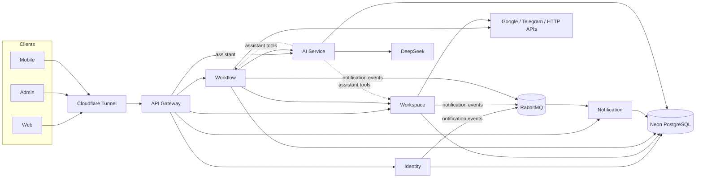

# Architecture overview

> Last verified 2026-11-02 against `dev` and `compose.prod.yml`. When this page and the code disagree, the code wins.
> Per-component detail lives in [docs/specs](../specs/README.md); business rules in the [rulebook](../rulebook.md).

## Components

| Component | Stack | Responsibility | Data | Spec |
| --- | --- | --- | --- | --- |
| Web | React + Vite | Builder, runs, monitoring, workspace settings | none | [web](../specs/apps/web.md) |
| Admin | React + Vite | Admin console (users, workspaces, executions) | none | [admin](../specs/apps/admin.md) |
| Mobile | React Native + Expo | Companion app: monitor and control, no builder | none | [mobile](../specs/apps/mobile.md) |
| API Gateway | NestJS | Single public entry: bearer check, size and rate limits, routing | none | [api-gateway](../specs/services/api-gateway.md) |
| Identity | Spring Boot | Accounts, sessions, Google sign-in, access tokens (HS256, or RS256 with JWKS) | Neon `identity` schema | [identity](../specs/services/identity-service.md) |
| Workspace | Spring Boot | Workspaces, members, invitations, connections and encrypted credentials | Neon `workspace` schema | [workspace](../specs/services/workspace-service.md) |
| Workflow | Spring Boot | Drafts, versions, publish, triggers, executions, node runtime, AI generation | Neon `workflow` schema | [workflow](../specs/services/workflow-service.md) |
| AI | NestJS | DeepSeek calls for AI nodes, generation and the assistant | Neon (BYOK provider keys) | [ai](../specs/services/ai-service.md) |
| Notification | NestJS | Consumes notification events, keeps each user's inbox | Neon `notification` schema | [notification](../specs/services/notification-service.md) |
| OCR | FastAPI | Text extraction from documents (partner-owned; runs in the demo with the ONNX runtime, file source only) | none | [ocr](../specs/services/ocr-service.md) |

Infrastructure: RabbitMQ (exchange `weav.events`), Neon PostgreSQL in `ap-southeast-1` with one database per service,
Cloudflare R2 for avatars, Cloudflare Tunnel for public access, SMTP for email.

## How the pieces talk

- **Auth.** Identity issues access tokens. The Gateway checks the bearer and forwards it unchanged; each service verifies it
  again (shared secret, or Identity's JWKS when RS256 is on).
- **Service to service.** Workflow and Workspace call each other's internal routes with a service key header
  (`WEAV_INTERNAL_SERVICE_KEY` outbound, `WORKFLOW_INTERNAL_SERVICE_KEY` inbound on Workflow). Workflow calls AI with a
  service JWT that AI checks against Workflow's JWKS file.
- **Running a workflow.** A trigger (manual, webhook, schedule, Telegram, Gmail) creates an execution. Workflow runs the
  nodes in order, asks Workspace for the credentials a node's connection needs, and calls the external API.
- **AI generation.** Gateway → Workflow → AI. Workflow compiles the model's intent into a draft and reports missing
  values or connections (or leaves them blank when the user asks for a draft).
- **Notifications.** Producers publish v2 events ([contract](../../packages/contracts/events/notification/README.md))
  to RabbitMQ; Notification validates them and stores each recipient's inbox, read through the Gateway.

Contracts: HTTP OpenAPI files under [packages/contracts/http](../../packages/contracts/http), node schemas under
[packages/workflow-schema/nodes](../../packages/workflow-schema/nodes).

## Deployment (demo)

- One Azure VM (Indonesia Central, 2 vCPU / 8 GiB) runs `compose.prod.yml`. Only SSH is open; traffic arrives through the
  `weav-demo` Cloudflare Tunnel at `app.`, `api.` and `admin.weav.id.vn`.
- Databases are on the Neon `demo` branch. OCR runs on the same VM (ONNX runtime, `file` source only; [runbook](../deployment/demo-runbook.md#7c-ocr-ocr-service-onnx-file-source-only)).
- Continuous delivery: when CI passes on `main`, the `publish-images` job pushes images to GHCR; `weav-deploy.timer` on
  the VM pulls them every 2 minutes and recreates changed containers (`scripts/deploy-pull.sh`).
- Step-by-step: [demo runbook](../deployment/demo-runbook.md). Public-surface rules: [deployment exposure](deployment-exposure.md).

## Key decisions

| Date | Decision | Why | Record |
| --- | --- | --- | --- |
| 2026-09 | One Neon database per service; no service reads another's tables | Service boundaries, no local DB on our laptops | [rulebook](../rulebook.md) |
| 2026-10-03 | RS256 access tokens as an option, HS256 default | Services verify without the signing secret | [design](jwt-asymmetric-signing-design.md) |
| 2026-10-04 | Remove bot-service; each workspace connects its own Telegram bot | Fewer services, no account linking | [bot-service (superseded)](../specs/services/bot-service.md) |
| 2026-10 | Generation goes through Workflow, not straight to AI (the Gateway only proxies the assistant) | Workflow owns drafts and validation | [ai design](../superpowers/specs/2026-09-25-ai-service-v1-design.md) |
| 2026-11-02 | Demo on Azure for Students, pull-based deploy from GHCR | Credit available, Neon is in Singapore, no inbound ports | [deployment log](../work_logs/K/platform/demo-deployment.md) |
